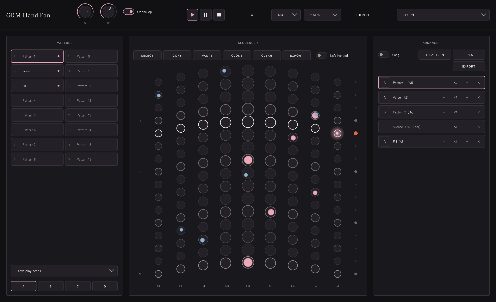

# GRM Hand Pan

A handpan whose sound is solved, not sampled. Every number the sound needs (how each tone field rings and for how
long, how the air in the shell answers, how a fingertip strikes, how the fields sing together) comes out of a **GRM
network**: physical relations solved against published measurements, each with its uncertainty. No samples, no
filter tuned by ear. Free software under the AGPL-3.0.



A D Kurd handpan in a VST3 / standalone plugin (JUCE), with its own sequencer, the **Hand Pan Roll**: draw strikes
on the instrument's fields, two hands at a time, and play them in patterns and songs. Or play it from MIDI. It is
still a young instrument (version 0.1): one scale, one way of striking.

## Audio examples

Rendered by the model alone, straight from `tools/` (no effect, no reverb, nothing edited), at 1 m from a D Kurd:

- **[A short piece](docs/audio/handpan_melody.mp3)** (50 s): the ding as a pulse, rolls between two fields, flams,
  a fast roll falling into an arpeggio, a sung phrase, a roll on the ding, a last chord left to ring. Listen for the
  neighbours that sing along and beat.
- **[The same piece, on the lap](docs/audio/handpan_melody_on_lap.mp3)**: the knees lengthen the Gu's neck, the air
  mode drops from 85 to 74 Hz, an octave below the ding.
- **[The scale](docs/audio/handpan_d_kurd.mp3)** (29 s): up and down the D Kurd, the ding soft, medium and loud (hear
  it grow brighter), then a chord.

## Download and play

Builds for **Windows** and **Linux** (VST3 and standalone) are attached to each
[release](https://github.com/innermost47/grm-hand-pan/releases); see below to build it yourself.

- **Windows**: copy the `GRM Hand Pan.vst3` folder to `C:\Program Files\Common Files\VST3` and rescan your plugins,
  or run `GRM Hand Pan.exe` and choose your audio device and MIDI input in its settings.
- **Linux**: copy the `GRM Hand Pan.vst3` folder to `~/.vst3`, or run the standalone `GRM Hand Pan`.

The first time it loads, the instrument calibrates itself on its measurements: it stays silent for about 15 seconds,
then plays.

### The Hand Pan Roll

- **The sequencer**, in the middle, is read from the bottom up: one line a step, each line the instrument's fields
  in an arc, the ding in the middle, the others alternating right and left as the scale rises. The lines of the bar's
  first beat, of the beats and of the off-beats stand out; the step playing lights its LED, and the notes that play
  glow.
- **Drawing**: click a field to put a strike there, and drag up or down to set how hard; drag a strike to make it
  louder or softer at any time. Ctrl + drag moves the selection, Ctrl + drag from elsewhere draws a selection
  rectangle, Ctrl + click adds a strike to the selection; a double-click removes one; a right click chooses its hand.
  Two strikes on one field at one step are a **flam**; a third strike at a step is refused: a player has two hands.
  The usual shortcuts work: Ctrl + A, C, X, V, D (clone), Z, Shift + Z or Y, Delete, Escape.
- **Two hands**: each strike is played by the hand of its side, the fields in the middle in turn, pink for the right
  hand, blue for the left; a left-hander's switch mirrors the roll.
- **Patterns**, on the left: four banks (A to D) of sixteen patterns, each with its name, its time signature and its
  length (1 to 16 bars); a right click renames, copies, pastes or clears one.
- **The arranger**, on the right: the song as blocks read from the top down, each a pattern played a number of times
  (its letter picks the variation, A2 to B2...) or a silence in the signature you choose. Drag a pattern in from the
  left, drag a block to move it, Ctrl + Z to undo. **Song** plays it instead of the pattern being edited.
- **MIDI**: by default the keys play notes (**D3 A3 Bb3 C4 D4 E4 F4 G4 A4**, each at its velocity; other notes are
  silent). Switched to **Keys play patterns**, the 64 keys from C1 (middle C = C3) play the 64 patterns, bank after
  bank, each from the next bar line while its key is held.
- **Export**: the pattern being edited, or the song, to a 24-bit stereo WAV file.
- **Settings**: the volume (V), the stereo width (W), the instrument **on the lap** (on by default), the tempo (in
  the standalone; in a host, the host's).

Everything (patterns, song, hands) is saved with your project.

## Status

| Part | State |
| --- | --- |
| Tone fields: tuned and untuned modes, their losses, their radiation | done |
| The cavity's air mode (Helmholtz) and the Gu | done |
| The fingertip strike: a pulp that hardens as it is pressed | done |
| How a strike excites each mode, calibrated on recorded notes | done |
| Sympathetic fields: neighbours that sing and beat | done |
| The finger's click above the modes (plate theory) | done |
| Stereo: each field heard from where it sits on the instrument | done |
| VST3 / standalone plugin, MIDI notes or patterns | done |
| The Hand Pan Roll: sequencer, two hands, flams, patterns, arranger, WAV export | done |
| A sharper finger attack, matched to finger recordings | next |
| Other scales, playing gestures (palm, muted, harmonics), the room | later |

## How it sounds the way it does

The sound path is the one of [GRM Guitar](https://github.com/innermost47/grm-guitar-vst): networks are solved when
something changes, never in the audio callback; their results are plain data that a real-time engine plays.

- **A tone field** is a steel plate tuned to its note. Its network ties the note to the sheet's thickness and the
  steel's stiffness and density, and gives the plate's effective radius (a D3 field about 10.6 cm, an A4 about
  6.1 cm). Its three tuned modes stand in the ratios 1 : 2 : 3 within the 3 % spread measured on real fields; two
  untuned modes, with two nodal diameters, sit near 7.5 and 8.2 times the fundamental.
- **How long each mode rings** is a law solved from 84 decay times measured mode by mode on four handpans from three
  makers: it depends on the field (higher fields ring shorter), not on the mode's frequency, and the octave rings
  longest (about 2.9 s for an A4 field, against 2.3 s for its fundamental).
- **Radiation**: the fundamental and the octave radiate as monopoles, the compound fifth as a dipole, as measured
  with an intensity probe; the parts of a field moving in opposite phases are summed over all directions.
- **The cavity** is a Helmholtz resonator. Its geometry is not published, so the network takes the measured air
  mode (85 Hz played free, 74 Hz on the lap) and the published size of the vessel, and solves the effective neck of
  the Gu and the losses it radiates. The ding pushes air into the cavity; the plug of air in the Gu answers.
- **The strike**: a fingertip lands on its pulp, which is soft at first and hardens as it is pressed (measured by
  MRI). A faster finger presses harder for a shorter time: a loud note is brighter. The finger keeps 19 % of the
  energy and bounces back.
- **Which modes a strike excites** at the sweet spot is solved from recorded notes: the octave and the fifth well,
  the untuned modes about 30 dB less than if a strike excited every mode alike.
- **Sympathy**: modes of different fields exchange their energy (a D3's octave sets the D4 ringing, its fifth the
  A4), at a coupling rate solved from two measurements: how long a coupled mode takes to rise, and how much energy
  free neighbours add to a strike. Each instrument has its own small mistuning, drawn from measured beatings, so
  near-unisons beat (about 7 Hz).
- **The finger's click**: while it pushes, the fingertip accelerates the volume the sheet sweeps by F / ρs (Newton),
  which the shell radiates as a baffled source. Below a field's highest mode that is already in the modes; above it,
  the click is heard. A soft strike barely clicks, a hard one clearly does.
- **The level** is physics too: the reference tap on the ding gives 74 dB SPL at 1 m, without any gain set by ear.
- **Stereo**: the ding sits in the middle, the lowest field of the ring in front of the player (struck with the right
  hand), then the scale goes up left, right, left... the highest at the back. Each field, and its click, is heard
  from its side; the stereo width is a setting.
- **The two hands** strike alike by default: the dominant hand grips harder (12.7 % in right-handers), but a grip is
  not a tap, and trained percussionists' hands grow alike. The weaker hand's speed is a setting of the model.

## For developers: building your own instrument with the GRM

This project is built exactly like GRM Guitar, and its **developer documentation** is the way in:
**[GRM Guitar's docs](https://github.com/innermost47/grm-guitar-vst/tree/main/docs)**.

- [The GRM in practice](https://github.com/innermost47/grm-guitar-vst/blob/main/docs/grm.md): what a GRM network
  is, with an example that runs.
- [Architecture](https://github.com/innermost47/grm-guitar-vst/blob/main/docs/architecture.md): how networks become
  sound in real time (solver thread, lock-free mailbox, modal engine), the pattern this handpan follows.
- [Your own plugin with cppgrm](https://github.com/innermost47/grm-guitar-vst/blob/main/docs/your-own-plugin.md):
  start your own virtual instrument or effect on the GRM.
- [Contributing](https://github.com/innermost47/grm-guitar-vst/blob/main/docs/contributing.md): how settings,
  networks and tests are added.

Here, the networks of a handpan are in `core/` (`handpan_networks.hpp`, `cavity_network.hpp`,
`strike_network.hpp`, `participation_network.hpp`, `sympathy_network.hpp`), their measured data with their sources in
`constants/`, and each one is checked against its measurements in `tests/`.

## Build

You need **CMake 3.22+**, **Git** and a **C++17 compiler**. CMake downloads everything else: the GRM engine
([cppgrm](https://github.com/innermost47/cppgrm), one header) and [JUCE](https://juce.com) 8 for the plugin. It is
built on **Windows** (Visual Studio 2022) and **Linux**; JUCE also builds on macOS, but this project has not been
tried there yet.

### Windows

Install [Visual Studio 2022](https://visualstudio.microsoft.com/) (Community is free) with the **Desktop development
with C++** workload, [CMake](https://cmake.org/download/) and [Git](https://git-scm.com/). Then, in a terminal:

```bat
git clone https://github.com/innermost47/grm-hand-pan.git
cd grm-hand-pan
cmake -B build -G "Visual Studio 17 2022"
cmake --build build --config Release
```

The first configure downloads JUCE (a few minutes). Then:

- the **VST3** is `build\GRMHandPan_artefacts\Release\VST3\GRM Hand Pan.vst3`: copy the whole `GRM Hand Pan.vst3`
  folder to `C:\Program Files\Common Files\VST3` and rescan your plugins;
- the **standalone** is `build\GRMHandPan_artefacts\Release\Standalone\GRM Hand Pan.exe`: open it, choose your audio
  device and MIDI input in its settings.

### Linux (and macOS, untried)

```sh
git clone https://github.com/innermost47/grm-hand-pan.git
cd grm-hand-pan
cmake -B build -DCMAKE_BUILD_TYPE=Release
cmake --build build -j
```

On Linux, JUCE needs its usual development packages (ALSA, X11, Freetype... see JUCE's
[Linux dependencies](https://github.com/juce-framework/JUCE/blob/master/docs/Linux%20Dependencies.md)). The VST3 is
`build/GRMHandPan_artefacts/Release/VST3/GRM Hand Pan.vst3` (copy it to `~/.vst3`), the standalone
`build/GRMHandPan_artefacts/Release/Standalone/GRM Hand Pan`.

### Tests and offline renders

Add `-DGRMH_BUILD_TESTS=ON` to the configure line to build the tests and the tools (`-DGRMH_BUILD_PLUGIN=OFF` skips
JUCE and the plugin, and the tests that need it):

```bat
cmake -B build -DGRMH_BUILD_TESTS=ON
cmake --build build --config Release
ctest --test-dir build -C Release
```

Then render (the paths are those of a Visual Studio build; with a single-configuration generator, drop `Release\`):

```bat
mkdir renders
build\Release\render_scale renders\handpan_d_kurd.wav
build\Release\render_melody renders\handpan_melody.wav
build\Release\render_melody renders\handpan_melody_lap.wav --lap
build\Release\render_editor renders\editor.png
```

- `render_scale`: a D Kurd up and down its scale, the ding soft to loud, a chord.
- `render_melody`: a short piece, the ding as a pulse, rolls, flams, a sung phrase; `--lap` holds the instrument on
  the lap (the air mode drops from 85 to 74 Hz).
- `render_editor` and `render_design_system`: the plugin's window, and its design system, as PNG images.

The renderings are stereo. The other tools: `measure_recordings <folder> <notes...>` measures recorded notes against
the model with the meter of the tests, `probe_sympathy` shows how the sympathy network sees its unknown,
`probe_click` compares the attack of the recordings with the model's.

## Tests

Every network is checked against the measurements it comes from, and every test was seen failing on a deliberate
error before it was kept.

| ctest name | Checks |
| --- | --- |
| `grm_engine_solves` | the build and the GRM engine |
| `sourced_constants` | the published data and the spreads declared for them |
| `tone_field_network` | plate frequency equations (Bessel), the loss law against the measured decays, modes against measured fields |
| `cavity_network` | speed of sound, Helmholtz and radiation formulas, the lap lowering the air mode |
| `strike_network` | the impact, the hardening pulp, the force pulse's spectrum, louder is brighter |
| `sound_engine` | partials at the model's frequencies, decay, the air mode, the level, the lock-free mailbox |
| `mode_radiation` | monopole, dipole and quadrupole fields against their compact and incoherent limits |
| `mode_participation` | the calibrated instrument against the recorded notes |
| `sympathetic_fields` | energy kept by the exchange, the coupling against its measurements, the beatings |
| `finger_click` | the contact pulse, Newton over a baffle, the click left to the modes below them, louder is brighter |
| `field_layout` | where the fields sit and sound, constant-power stereo gains |
| `pattern_sequencer` | the grid, a circle as a velocity, the two hands, the weak hand, flams, the loop whatever the host's blocks |
| `transport_clock` | the host's clock or the plugin's own (play, pause, stop), the strikes of a block, bar.beat.step |
| `roll_layout` | the fields in an arc, mirrored for a left-hander, lines that never overlap, note names |
| `pattern_editing` | two strikes a step at most, moving and resizing a selection, copy, paste, clone, undo |
| `pattern_library` | the banks, a pattern's length and signature |
| `pattern_player` | a pattern asked for starts on the next bar line, let go it stops, whatever the host's blocks |
| `arrangement` | the song's blocks one after the other, repeats, silences in any signature, played once |
| `design_system` | the typefaces, text contrast (WCAG), the two hands' colours |
| `plugin_as_hosted` | the plugin called as a host would: MIDI to sound, stereo, the roll, the volume, keys playing patterns, the song, the WAV export, state |
| `plugin_editor` | the window: knobs and parameters, the transport, drawing with the mouse and the shortcuts, the banks, the arranger, the session saved bit for bit |

## Layout

- `constants/`: the measured data, each value with its source and its spread (the spread is its sigma in the
  networks), the choices that are not measurements (listening distance, full scale, MIDI velocity curve), and the
  design system (`theme.hpp`, `sizes.hpp`).
- `models/`: the structs that travel between the parts.
- `core/`: the networks, the model, the real-time engine (voices, cavity, sympathy), the sequencer (patterns, hands,
  transport, arrangement), the offline renderer. No JUCE: everything is tested and rendered without a host.
- `plugin/`: the JUCE plugin: the processor (parameters, MIDI, the solver thread, the engine in `processBlock`), its
  look and feel, views and widgets, the session's state, the WAV export.
- `assets/fonts/`: the interface's typefaces. `design/`: the mock-ups the interface comes from.
- `tools/`: renderers and measuring tools. `tests/`: one test per part.

## Sources

- F. Rohner, S. Schärer, "History, development and tuning of the HANG", Proc. ISMA 2007.
- A. Morrison, T. D. Rossing, "Modes of vibration and sound radiation from the Hang", Archives of Acoustics 32(3),
  551-560 (2007).
- D. Wessel, A. Morrison, T. D. Rossing, "Sound of the HANG", Proc. Mtgs. Acoust. 4, 035002 (2008).
- E. Alon, "Analysis and synthesis of the handpan sound", MSc by research, University of York (2015): the decay times,
  mode levels, beatings and coupling measurements this model is solved against.
- PANArt, the Hang book and the Hang Urgu product page (the air mode, the vessel's size).
- A. W. Leissa, "Vibration of plates", NASA SP-160 (1969). L. E. Kinsler, A. R. Frey et al., "Fundamentals of
  Acoustics" (2000). EN 1993-1-1 and EN 1991-1-1 (structural steel).
- A. Z. Hajian, R. D. Howe, "Identification of the mechanical impedance at the human finger tip", J. Biomech. Eng.
  (1997). D. L. Jindrich et al., "Non-linear viscoelastic models predict fingertip pulp force-displacement
  characteristics during voluntary tapping", J. Biomech. (2003), and "Finger joint impedance during tapping on a
  computer keyswitch" (2004). P. L. Kuo et al., "Finger joint coordination during tapping", J. Biomech. (2006).
- J. Dallard, "Modélisation du doigt dans un contexte de manipulation fine", PhD thesis, Université Claude Bernard
  Lyon 1 (2016): the fingertip pulp measured by MRI.
- C. Xu, "Modal Synthesis of the Handpan Sound", MUMT 307, McGill University (2022): the recorded notes the strike is
  calibrated on (their levels are in `constants/recordings.hpp`; the recordings themselves are not redistributed).
- Petersen et al., "Grip strength and hand dominance: challenging the 10% rule", Am. J. Occup. Ther. (1989). Fujii et
  al., "Tapping speed asymmetry in drummers for single-hand tapping with a stick" (2006): the two hands.

## The GRM family

- **[grm-core](https://github.com/innermost47/grm-core)**: the Global Relational Model and the research it comes
  from.
- **[cppgrm](https://github.com/innermost47/cppgrm)**: the GRM engine, one C++17 header with no dependency.
- **[pygrm](https://pypi.org/project/pygrm/)**: the same engine as a Python package.
- **[GRM Guitar](https://github.com/innermost47/grm-guitar-vst)**: a guitar built the same way, whose architecture
  and developer documentation this project follows.

## License

AGPL-3.0-or-later, see [LICENSE](LICENSE).

The interface's typefaces, [Zen Kaku Gothic New](https://github.com/googlefonts/zen-kakugothic) and
[Shippori Mincho](https://github.com/fontdasu/ShipporiMincho), are under the SIL Open Font License 1.1
(`assets/fonts/`, reduced to their Latin glyphs, with their licenses).

Hang® is a registered trademark of PANArt Hangbau AG. This project models the handpan family of instruments; it is
not affiliated with or endorsed by PANArt.
